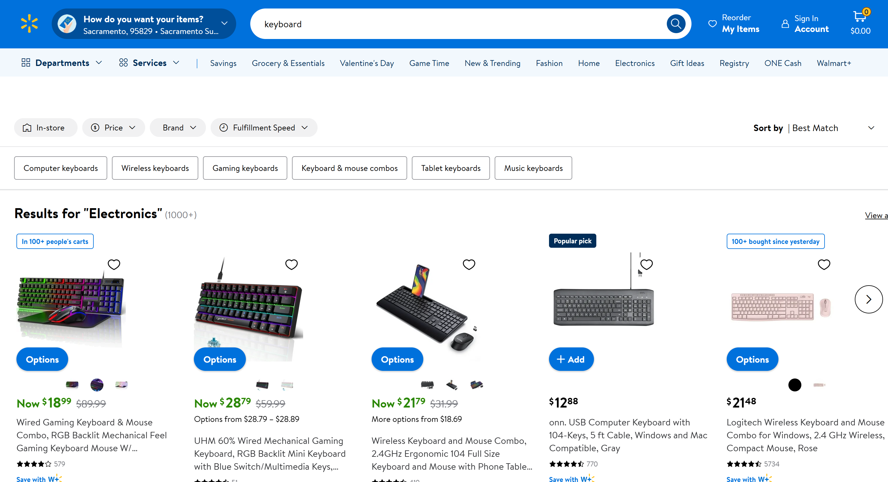
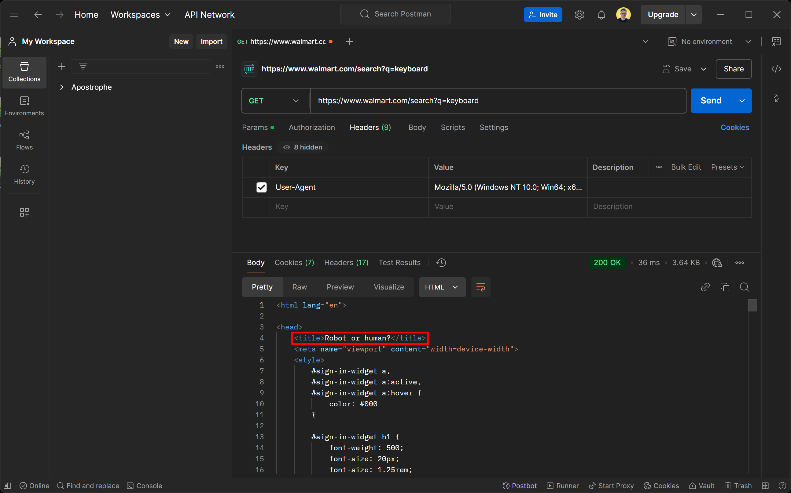

# 在 Python 中使用 curl\_cffi 进行网页爬虫

[](https://www.bright.cn/) 

本指南介绍如何使用 curl\_cffi 模拟真实浏览器的 TLS 指纹，从而增强 Python 网页爬虫脚本。

- [什么是 `curl_cffi`？](#什么是-curl_cffi)
- [工作原理](#工作原理)
- [如何使用 `curl_cffi` 进行网页爬虫](#如何使用-curl_cffi-进行网页爬虫)
  - [第 1 步：项目设置](#第-1-步项目设置)
  - [第 2 步：安装 `curl_cffi`](#第-2-步安装-curl_cffi)
  - [第 3 步：连接目标页面](#第-3-步连接目标页面)
  - [第 4 步：添加数据抓取逻辑](#第-4-步添加数据抓取逻辑)
  - [第 5 步：整合所有代码](#第-5-步整合所有代码)
- [`curl_cffi`：高级用法](#curl_cffi高级用法)
  - [选择要模拟的浏览器](#选择要模拟的浏览器)
  - [会话管理](#会话管理)
  - [代理集成](#代理集成)
  - [异步 API](#异步-api)
  - [WebSocket 连接](#websocket-连接)
- [用于网页爬虫时，`curl_cffi` 与 Requests、AIOHTTP 和 HTTPX 的对比](#用于网页爬虫时curl_cffi-与-requestsaiohttp-和-httpx-的对比)
- [用于网页爬虫的 `curl_cffi` 替代方案](#用于网页爬虫的-curl_cffi-替代方案)

## 什么是 `curl_cffi`？

[`curl_cffi`](https://github.com/lexiforest/curl_cffi) 通过 CFFI 为 `curl-impersonate` 分支提供 Python 绑定，因此可以模拟浏览器的 TLS/JA3/HTTP2 指纹。这有助于绕过基于 [TLS 指纹识别](https://www.bright.cn/blog/web-data/tls-fingerprinting)的反机器人拦截。

它的一些功能包括：

- 支持模拟 JA3/TLS 和 HTTP2 指纹，包括新版浏览器指纹和自定义指纹
- 比 `requests` 和 `httpx` 快得多，性能与 `aiohttp` 相当
- 模拟 `requests` API
- 支持使用 `asyncio` 执行异步 HTTP 请求
- 支持在每次请求时轮换代理
- 支持 HTTP/2.0 和 `WebSocket`

## 工作原理

发送 HTTPS 请求时，会进行一次 [TLS 握手](https://www.cloudflare.com/learning/ssl/what-happens-in-a-tls-handshake/)，并生成唯一的 TLS 指纹。由于 HTTP 客户端与网页浏览器的运行方式不同，其指纹可能暴露自动化行为，进而触发反机器人防御机制。

`curl_cffi` 所基于的 cURL Impersonate 对 cURL 进行定制，以复现真实的浏览器 TLS 指纹：

- **TLS 库调整**：使用浏览器采用的 TLS 连接库，而不是 cURL 使用的库。
- **配置更改**：调整 TLS 扩展和 SSL 选项以模拟浏览器。
- **HTTP/2 自定义**：匹配浏览器的握手设置。
- **非默认 cURL 标志**：设置 `--ciphers`、`--curves` 和自定义标头，以提高准确性。

这会使请求看起来像是由真实浏览器发出的，从而帮助绕过机器人检测。

## 如何使用 `curl_cffi` 进行网页爬虫

让我们尝试抓取沃尔玛的“Keyboard”页面：  



如果你尝试使用任何 HTTP 客户端访问此页面，将收到以下错误页面：  



由于存在 TLS 指纹识别，即使将 `User-Agent` 设置为模拟真实浏览器，你仍会看到这个机器人检测页面。这正是 `curl_cffi` 可以发挥作用的地方。

### 第 1 步：项目设置

确保你的计算机上已安装 Python 3 或更高版本。然后，为你的 `curl_cffi` 抓取项目创建一个目录：

```
mkdir curl-cfii-scraper
```

进入该目录并设置[虚拟环境](https://docs.python.org/3/library/venv.html)：

```
cd curl-cfii-scraper
python -m venv env
```

使用你偏好的 Python IDE 打开项目文件夹，并在该文件夹中创建一个 `scraper.py` 文件。

在 IDE 的终端中激活虚拟环境。在 Linux 或 macOS 上，使用：

```bash
./env/bin/activate
```

在 Windows 上，运行：

```bash
env/Scripts/activate
```

### 第 2 步：安装 `curl_cffi`

在已激活的虚拟环境中安装该 HTTP 客户端：

```
pip install curl-cffi
```

### 第 3 步：连接目标页面

从 `curl_cffi` 导入 `requests`：

```python
from curl_cffi import requests
```

该对象提供类似 Requests 的高级 API。你可以使用它向目标页面发送 GET HTTP 请求：

```python
response = requests.get("https://www.walmart.com/search?q=keyboard", impersonate="chrome")
```

`impersonate="chrome"` 参数会指示 `curl_cffi` 让 HTTP 请求看起来像是来自最新版本的 Chrome。这会让沃尔玛将自动请求视为普通浏览器请求，并返回标准网页。

你可以通过以下方式访问目标页面的 HTML 内容：

```python
html = response.text
```

如果打印 `html`，你将看到：

```html
<!DOCTYPE html>
<html lang="en-US">
   <head>
      <meta charSet="utf-8"/>
      <meta property="fb:app_id" content="105223049547814"/>
      <meta name="viewport" content="width=device-width, initial-scale=1.0, minimum-scale=1, interactive-widget=resizes-content"/>
      <link rel="dns-prefetch" href="https://tap.walmart.com "/>
      <link rel="preload" fetchpriority="high" crossorigin="anonymous" href="https://i5.walmartimages.com/dfw/63fd9f59-a78c/fcfae9b6-2f69-4f89-beed-f0eeb4237946/v1/BogleWeb_subset-Bold.woff2" as="font" type="font/woff2"/>
      <link rel="preload" fetchpriority="high" crossorigin="anonymous" href="https://i5.walmartimages.com/dfw/63fd9f59-a78c/fcfae9b6-2f69-4f89-beed-f0eeb4237946/v1/BogleWeb_subset-Regular.woff2" as="font" type="font/woff2"/>
      <link rel="preconnect" href="https://beacon.walmart.com"/>
      <link rel="preconnect" href="https://b.wal.co"/>
      <title>Electronics - Walmart.com</title>
      <!-- omitted for brevity ... -->
```

### 第 4 步：添加数据抓取逻辑

要执行网页爬虫，你还需要使用 [BeautifulSoup](https://www.crummy.com/software/BeautifulSoup/bs4/doc/) 之类的 HTML 解析库：

```bash
pip install beautifulsoup4
```

在 `scraper.py` 中导入它：

```python
from bs4 import BeautifulSoup
```

使用它解析页面的 HTML：

```python
soup = BeautifulSoup(response.text, "html.parser")
```

[`"html.parser"`](https://docs.python.org/3/library/html.parser.html) 是 Python 标准库提供的默认 HTML 解析器，BeautifulSoup 使用它解析 HTML 字符串。它包含用于选择页面 HTML 元素并从中提取数据的方法。

下一个示例演示如何仅抓取页面标题。你可以使用 `find()` 方法，通过 [CSS 选择器](https://developer.mozilla.org/en-US/docs/Web/CSS/CSS_selectors)选中标题，然后使用 `text` 属性访问其文本：

```python
title_element = soup.find("title")
title = title_element.text
```

打印页面标题：

```python
print(title)
```

### 第 5 步：整合所有代码

以下是最终的 `curl_cffi` 网页爬虫脚本：

```python
from curl_cffi import requests
from bs4 import BeautifulSoup

# Send a GET request to the Walmart search page for "keyboard"
response = requests.get("https://www.walmart.com/search?q=keyboard", impersonate="chrome")

# Extract the HTML from the page
html = response.text

# Parse the response content with BeautifulSoup
soup = BeautifulSoup(response.text, "html.parser")

# Find the title tag using a CSS selector and print it
title_element = soup.find("title")
# Extract data from it
title = title_element.text

# More complex scraping logic...

# Print the scraped data
print(title)
```

运行它：

```bash
python3 scraper.py
```

在 Windows 上：

```bash
python scraper.py
```

结果如下：

```
Electronics - Walmart.com
```

如果移除 `impersonate="chrome"` 参数，则会得到：

```
Robot or human?
```

## `curl_cffi`：高级用法

### 选择要模拟的浏览器

`curl_cffi` 支持模拟多种浏览器，你可以将其特有标签传递给 `impersonate` 参数：

```python
response = requests.get("<YOUR_URL>", impersonate="<BROWSER_LABEL>")
```

你可以使用以下标签：

- `chrome99`, `chrome100`, `chrome101`, `chrome104`, `chrome107`, `chrome110`, `chrome116`, `chrome119`, `chrome120`, `chrome123`, `chrome124`, `chrome131`
- `chrome99_android`, `chrome131_android`
- `edge99`, `edge101`
- `safari15_3`, `safari15_5`, `safari17_0`, `safari17_2_ios`, `safari18_0`, `safari18_0_ios`

以下是一些建议：

1.  如需始终模拟最新版本的浏览器，只需使用 `chrome`、`safari` 和 `safari_ios`。
2.  [Firefox 目前不可用](https://github.com/lexiforest/curl_cffi/issues/59)，因为它使用 NSS，而其他浏览器使用 boringssl，并且 curl 同一时间只能链接一个 TLS 库。
3.  仅当浏览器指纹发生变化时，才会添加对应版本。如果某个版本被跳过，你仍可通过使用上一版本的标头来模拟它。
4.  对于非浏览器目标，请使用 `ja3`、`akamai` 和类似参数指定你自己的自定义 TLS 指纹。详情请参阅[模拟功能文档](https://curl-cffi.readthedocs.io/en/latest/impersonate.html)。

### 会话管理

`curl_cffi` 可以使用 [`Session`](https://requests.readthedocs.io/en/latest/user/advanced/#session-objects) 对象，在多个请求之间保留特定参数，例如 Cookie、标头或其他会话专用数据。

以下是代码示例：

```python
# Create a new session
session = requests.Session()

# This endpoint sets a cookie on the server
session.get("https://httpbin.io/cookies/set/userId/5", impersonate="chrome")

# Print the session's cookies to confirm they are being stored
print(session.cookies)
```

上述脚本的输出如下：

```
<Cookies[<Cookie userId=5 for httpbin.org />]>
```

结果证明该会话能够在多个请求之间保持状态，例如存储服务器设置的 Cookie。

### 代理集成

与 `requests` 库一样，`curl_cffi` 支持通过 `proxies` 对象集成代理：

```python
# Define your proxy URL
proxy = "YOUR_PROXY_URL"

# Create a dictionary of proxies for HTTP and HTTPS
proxies = {"http": proxy, "https": proxy}

# Make a request using a proxy and browser impersonation
response = requests.get("<YOUR_URL>", impersonate="chrome", proxies=proxies)
```

### 异步 API

`curl_cffi` 支持通过 [`AsyncSession`](https://curl-cffi.readthedocs.io/en/latest/api.html#curl_cffi.requests.AsyncSession) 对象，使用 `asyncio` 执行异步请求：

```python
from curl_cffi.requests import AsyncSession
import asyncio

# Define an async function to execute the asynchronous code
async def fetch_data():
    async with AsyncSession() as session:
        # Perform the asynchronous GET request
        response = await session.get("https://httpbin.org/anything", impersonate="chrome")
        # Print the response text
        print(response.text)

# Run the async function
asyncio.run(fetch_data())
```

使用 `AsyncSession` 可以更轻松地高效处理多个异步请求。

### WebSocket 连接

`curl_cffi` 还通过 [`WebSocket`](https://curl-cffi.readthedocs.io/en/latest/api.html#curl_cffi.requests.Session.ws_connect) 类支持 `WebSocket`：

```python
from curl_cffi.requests import WebSocket


# Define a callback function to handle incoming messages
def on_message(ws, message):
    print(message)

# Initialize the WebSocket connection with the callback
ws = WebSocket(on_message=on_message)

# Connect to a sample WebSocket server and listen for messages
ws.run_forever("wss://api.gemini.com/v1/marketdata/BTCUSD")
```

这对于从使用 `WebSocket` 动态填充数据的网站或 API 抓取实时数据尤其有用。

你无需抓取渲染后的页面，而是可以直接以 `WebSocket` 通道为目标，高效获取数据。

> **注意**：\
> 借助 [`AsyncWebSocket`](https://curl-cffi.readthedocs.io/en/latest/api.html#curl_cffi.requests.AsyncSession.ws_connect) 类，你可以异步使用 `WebSocket`。

## 用于网页爬虫时，curl\_cffi 与 Requests、AIOHTTP 和 HTTPX 的对比

下表对用于网页爬虫的 `curl_cffi` 与其他热门 Python HTTP 客户端进行了比较：

| **功能** | **curl\_cffi** | **Requests** | **AIOHTTP** | **HTTPX** |
| --- | --- | --- | --- | --- |
| **同步 API** | ✔️  | ✔️  | ❌   | ✔️  |
| **异步 API** | ✔️  | ❌   | ✔️  | ✔️  |
| **支持** `**WebSocket**` | ✔️  | ❌   | ✔️  | ❌   |
| **连接池** | ✔️  | ✔️  | ✔️  | ✔️  |
| **支持 HTTP/2** | ✔️  | ❌   | ❌   | ✔️  |
| `**User-Agent**` **自定义** | ✔️  | ✔️  | ✔️  | ✔️  |
| **TLS 指纹伪装** | ✔️  | ❌   | ❌   | ❌   |
| **速度** | 高 | 中 | 高 | 中 |
| **重试机制** | ❌   | 可通过 `HTTPAdapter` 使用 | 仅可通过第三方库使用 | 可通过内置 `Transport` 使用 |
| **代理集成** | ✔️  | ✔️  | ✔️  | ✔️  |
| **Cookie 处理** | ✔️  | ✔️  | ✔️  | ✔️  |

## 用于网页爬虫的 `curl_cffi` 替代方案

`curl_cffi` 需要采用手动方式进行网页爬虫，大部分代码都必须手动编写。虽然它对简单的静态网站很有效，但在处理动态网站或安全性极高的网站时可能面临挑战。

Bright Data 提供多种 `curl_cffi` 替代方案：

- [抓取浏览器 API](https://www.bright.cn/products/scraping-browser)：完全托管的云浏览器实例，可与 Puppeteer、Selenium 和 Playwright 无缝集成。这些浏览器内置 CAPTCHA 破解功能，并支持自动轮换代理。
- [网页爬虫工具 API](https://www.bright.cn/products/web-scraper)：预配置端点可提供来自 100 多个热门域名的最新结构化数据。
- [无代码抓取工具](https://www.bright.cn/products/web-scraper/no-code)：易于使用的按需数据采集服务，无需编写代码。
- [数据集](https://www.bright.cn/products/datasets)：浏览来自不同网站的预构建数据集，或根据你的具体需求定制数据采集。

立即创建免费的 Bright Data 账户，测试我们的代理和爬虫解决方案！
